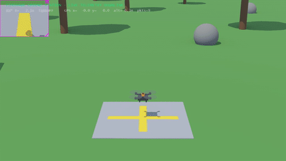
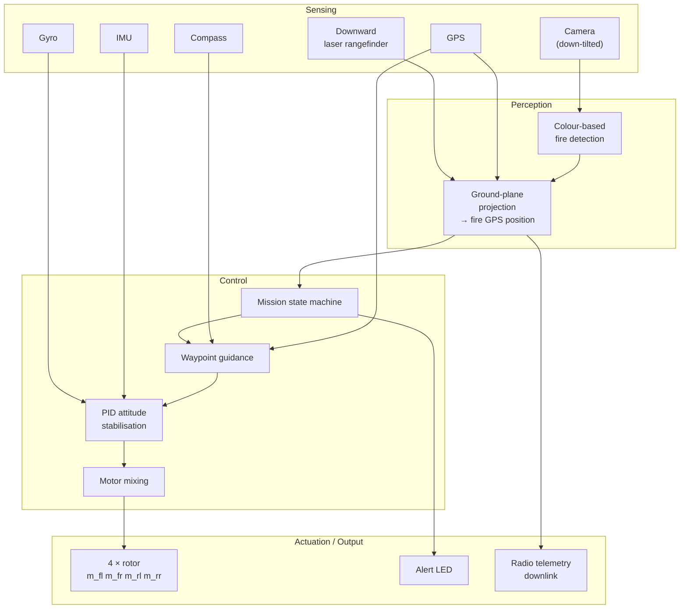
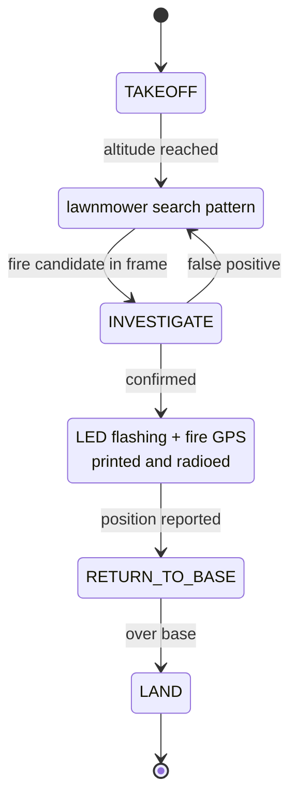

# FireHawk Mk1 — Autonomous Wildfire Spotting Drone

A fully custom quadcopter, built from Webots base nodes with **no existing robot
models or PROTOs**, that autonomously patrols a forest, detects a wildfire with
its onboard camera, confirms it, reports the estimated fire GPS position, then
returns to base and lands.



▶️ **[Full demo video](https://youtu.be/REPLACE_WITH_YOUR_LINK)**

---

## Why this is non-trivial

The airframe is not a library model. Attitude stabilisation, mixing, guidance
and the mission state machine are all implemented from scratch on top of raw
Webots sensors and four independently commanded rotors.

## System architecture



## Mission state machine



Press `M` in the 3D window at any point to take manual keyboard control
(arrow keys = translate, `A`/`D` = yaw, `W`/`S` = climb/descend, `M` = return
to autonomous).

## Repository layout

```
controllers/wildfire_drone/
    wildfire_drone.py     flight controller — PID stabilisation, guidance,
                          fire detection, ground projection, state machine,
                          keyboard override
worlds/
    wildfire.wbt          forest world + the FireHawk robot, defined from
                          Webots base nodes: 4 propellers, down-tilted camera,
                          GPS, IMU, gyro, compass, downward laser rangefinder,
                          alert LED, radio emitter
```

## Running it

**Requirements**
- Webots R2023b (runs on Ubuntu 20.04; newer Webots releases need Ubuntu 22.04+)
- Python 3.8+ available as `python3`

```bash
# Launch Webots, then:
#   File → Open World → worlds/wildfire.wbt
#   Press Play
```

## How the fire position is estimated

The camera is fixed at a known downward tilt. When a fire-coloured region is
detected, its centroid in image space is projected onto the ground plane using
the drone's current attitude and its height above terrain from the downward
rangefinder. That ground-frame offset is then added to the drone's GPS fix to
give an estimated fire position, which is printed to the console and sent over
the radio emitter.

Accuracy therefore depends on attitude estimate quality and on the ground being
locally flat — a reasonable assumption at patrol altitude over forest.

## Notes

Built for CO7048 Robotics. The Webots installation itself is not included in
this repository — install it separately from
[cyberbotics.com](https://cyberbotics.com/).
